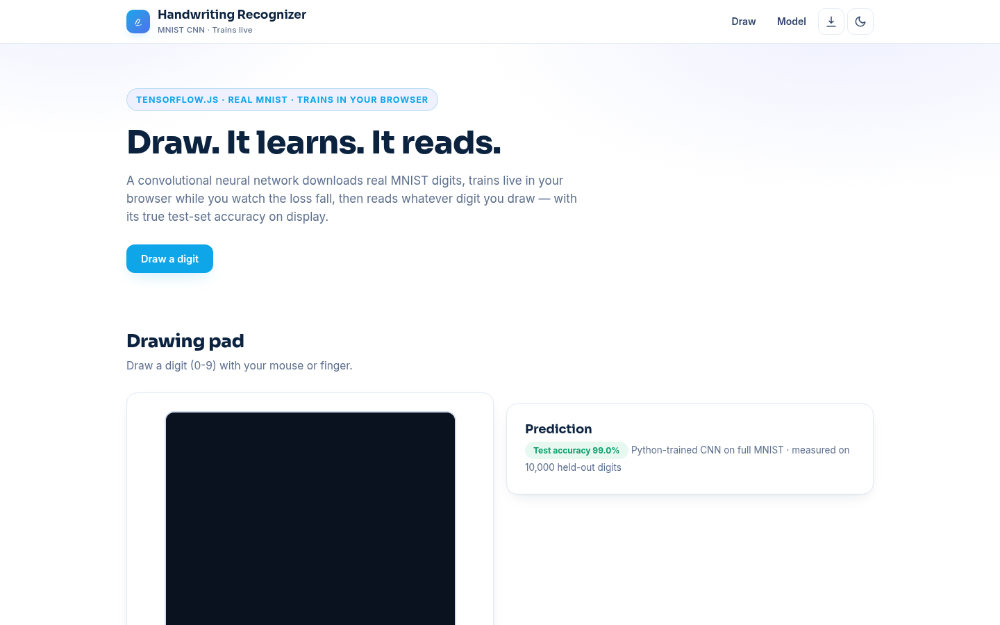

# Handwriting Recognizer — Draw a Digit, Watch a CNN Learn

**Live:** https://akash991833.github.io/handwriting-recognizer/

A convolutional neural network downloads real MNIST digits, trains live in your browser while you watch the loss fall, then reads whatever digit you draw — with its true held-out test accuracy on display. Free, private, no sign-up.



## Features

- **Live training** — a 2-conv-layer CNN trains on 4,000 real MNIST digits in about a minute, with live loss and validation accuracy
- **Honest accuracy** — the displayed number is measured on 1,200 held-out test digits (90.0% in the shipped run), not a marketing claim
- **Drawing pad** — mouse and touch, big strokes on a dark pad, instant prediction on release
- **Top-3 predictions** — confidence bars for the three most likely digits
- **PWA** — installable; the app shell and TF.js runtime cache for offline use (the MNIST download needs one online visit)
- **Dark & light themes**, responsive on mobile and desktop

## How it works

1. **Data** — MNIST sprite + labels from the free Google-hosted tfjs tutorial dataset, decoded into tensors in-browser
2. **Model** — conv(8) → pool → conv(16) → pool → dropout → dense(64) → softmax(10), trained with Adam for 2 epochs
3. **Preprocessing** — your drawing is scaled to 28×28, centered and normalized like MNIST
4. **Prediction** — softmax probabilities drive the top-3 confidence bars

## Honest limits

The model knows printed-style digits 0-9 from MNIST: big, centered strokes work best. It cannot read letters, multi-digit numbers or messy cursive. 90% test accuracy on MNIST digits is not 90% on your handwriting — styles differ, and the model trains on a 4,000-image subset so it finishes quickly (full MNIST would score higher). Training uses the CPU backend for reliability, so the first minute is the price of admission.

## Tech

Vanilla HTML/CSS/JS + TensorFlow.js (CDN). No build step, no backend, no tracking.

## Run locally

```bash
python3 -m http.server 8000
# open http://localhost:8000
```

Built by [Akash Vishwakarma](https://github.com/AKASH991833). Free to use — no sign-up, no card.
